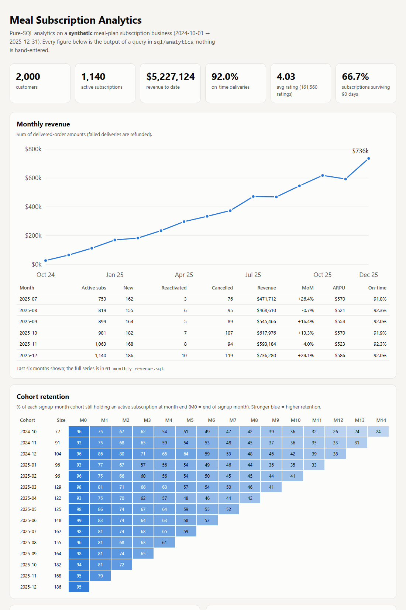
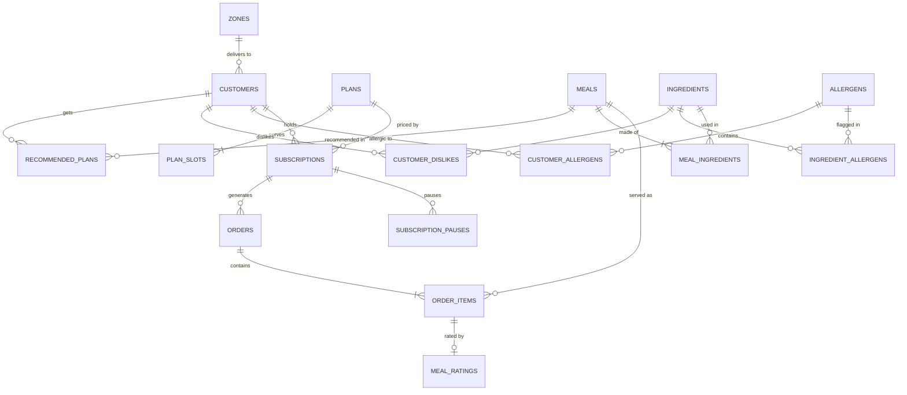

# Meal Subscription Analytics

[](https://github.com/Vivan-coder/meal-subscription-analytics/actions/workflows/ci.yml)


**An end-to-end SQL project for a personalized meal-plan subscription business** (the kind of company that delivers
chef-cooked, calorie-targeted meals every day). It combines three things a data team at such a company actually does:

1. **Subscription analytics** - revenue, cohort retention, churn drivers, customer value.
2. **A personalized meal-plan recommender** - allergen-safe, calorie-targeted weekly menus built from SQL constraints.
3. **Customer-feedback analysis** - which meals, ingredients and delivery problems move ratings and cancellations.

Everything runs on **SQLite with zero third-party dependencies**: clone, run one command, get a fully populated
database, 14 analytics queries, a recommender, and an interactive-looking HTML dashboard.

**[Live dashboard](https://vivan-coder.github.io/meal-subscription-analytics/)** ·
[Analytics queries](sql/analytics) · [Schema](sql/schema.sql) · [Recommender SQL](sql/recommend)



> **The data is synthetic.** It is generated by a seeded behavioural simulation (see [Data](#the-data-is-synthetic-and-says-so)),
> so every result here is reproducible. Nothing in this repository is real customer data.

---

## Key findings

Produced by `python -m mealsub build` (default seed 42): 2,000 customers · 171,711 delivery orders · 500,943 meals
served · 161,560 ratings · $5.23M revenue, Oct 2024 - Dec 2025.

| Question | Answer (from the SQL) | Query |
|---|---|---|
| How fast do subscribers leave? | **66.7%** of subscriptions survive 90 days, **52.3%** survive 180 | [05](sql/analytics/05_survival_curve.sql) |
| Which channel retains best? | Referral churns **8.0** per 100 subscriber-months vs **16.1** for promo (2.0x); a referral customer is worth **27% more** so far ($2,924 vs $2,311) | [03](sql/analytics/03_churn_by_segment.sql), [08](sql/analytics/08_customer_value.sql) |
| Is there a delivery problem? | Zone F is late **18.1%** of the time vs 3.9% in Zone A, churns at **20.9** vs 10.2, and **43.6%** of its cancellations cite delivery (19-25% elsewhere) | [12](sql/analytics/12_delivery_by_zone.sql) |
| Do early bad deliveries predict churn? | Cancelled in days 28-90: **17.2%** with zero late/failed deliveries in the first 28 days, **26.5%** with one, **29.1%** with two or more | [06](sql/analytics/06_delivery_vs_churn.sql) |
| What does a late delivery cost in ratings? | Average rating falls from **4.09** to **3.24**; low (<=2) ratings jump from 2.1% to 16.5% | [13](sql/analytics/13_rating_by_delivery_status.sql) |
| Which ingredients hurt? | Meals with okra rate **1.16 points lower** (z = -94); eggplant -0.78, tofu -0.55. Salmon (+0.47) and shrimp (+0.36) lift ratings | [11](sql/analytics/11_ingredient_effects.sql) |
| How concentrated is revenue? | The top 20% of customers produce **49.2%** of revenue | [09](sql/analytics/09_revenue_concentration.sql) |
| Does the recommender work? | **1,140** active customers planned, **5,700** customer-days, **0** allergen / dislike / slot / repeat violations, **99.95%** of days within +/-10% of the calorie target | [recommend/](sql/recommend) |
| Is the fortnight after a pause risky? | Directionally yes (12.9 vs 11.6 cancellations per 100 subscriber-months) but from only 56 events - **too few to call** | [07](sql/analytics/07_pause_behavior.sql) |

---

## Quickstart

Requires **Python 3.10+** (SQLite 3.35+ ships with it). No `pip install` needed to run.

```bash
git clone https://github.com/Vivan-coder/meal-subscription-analytics.git
cd meal-subscription-analytics

python -m mealsub all                 # build DB (~10 s) -> weekly plans for all active customers -> docs/index.html
python -m mealsub query               # list the 14 analytics queries
python -m mealsub query 02            # cohort retention
python -m mealsub query 11 --limit 12 # ingredient effects
python -m mealsub recommend --customer 3        # one customer's week, printed
python -m mealsub verify              # run the 14-check data-integrity audit
```

```text
$ python -m mealsub recommend --customer 3
customer 3  target 1800 kcal / 126 g protein  week of 2026-01-05

Mon 2026-01-05   1732 kcal   144 g protein
  breakfast Salmon Cucumber Toast                      365 kcal   27.3 g
  lunch     Salmon Poke Bowl                           614 kcal   36.7 g
  dinner    Mediterranean Chicken with Feta            593 kcal   66.4 g
  snack     Boiled Eggs with Tomatoes                  161 kcal   13.5 g
```

Run the tests (needs `pip install pytest`): `python -m pytest` - **92 tests, ~45 s**.

---

## How it fits together

```text
catalog.py ──┐
             ├─> generate.py ──> SQLite ──> sql/checks/integrity.sql   (14 invariants, must all be 0)
(simulation) ┘     (seeded)        │    └─> triggers armed (guard every later write)
                                   ├─> sql/analytics/*.sql  ──> report.py ──> docs/index.html
                                   └─> sql/recommend/*.sql  ──> recommend.py ──> recommended_plans
                                                                   └─> sql/recommend/validate_plans.sql (independent audit)
```

SQL does the work; Python only orchestrates, runs the small combinatorial search in the recommender, and lays out the report.
Every business metric is defined once, in a `.sql` file or view.

### Schema



Design points worth noting:

* **Meal nutrition is derived, not typed in.** Calories and macros are computed in `v_meal_nutrition` from
  `meal_ingredients.grams x ingredients.*_per_100g`, so a recipe change updates everything consistently.
* **Allergens flow through ingredients** (`v_meal_allergens`), so a meal's allergen list can never disagree with its recipe.
* **No redundant status column.** A subscription is active iff `end_date IS NULL`; a `CHECK` ties `cancel_reason` to
  `end_date`, so the two cannot drift apart. Money is integer cents; dates are ISO text.
* **Failed deliveries are refunded** and cannot be rated: enforced by a `CHECK` (amount is 0 exactly when the order failed)
  and a trigger.

---

## SQL techniques on show

| Technique | Where |
|---|---|
| Recursive CTEs (month spine, cohort offsets) | [01](sql/analytics/01_monthly_revenue.sql), [02](sql/analytics/02_cohort_retention.sql) |
| Window functions: `LAG`, `RANK`, `NTILE`, running totals, share-of-total | 01, [04](sql/analytics/04_cancellation_reasons.sql), [09](sql/analytics/09_revenue_concentration.sql), [10](sql/analytics/10_meal_ratings.sql), [14](sql/analytics/14_feedback_tags.sql) |
| Exposure-adjusted rates (survivorship-bias-free churn) | [03](sql/analytics/03_churn_by_segment.sql), [07](sql/analytics/07_pause_behavior.sql), view `v_subscription_exposure` |
| Observability / censoring-aware cohorts | [05](sql/analytics/05_survival_curve.sql), [06](sql/analytics/06_delivery_vs_churn.sql) |
| Statistics in SQL: shrinkage estimator, Welch z-score from sums of squares | view `v_meal_rating`, [11](sql/analytics/11_ingredient_effects.sql) |
| Anti-joins (`NOT EXISTS`) as hard constraints | [eligible_meals.sql](sql/recommend/eligible_meals.sql) |
| One CTE per fact table to avoid join fan-out | [12](sql/analytics/12_delivery_by_zone.sql) |
| Triggers for temporal integrity, set-based audit queries | [triggers.sql](sql/triggers.sql), [integrity.sql](sql/checks/integrity.sql) |
| Views as a single source of truth for metrics | [views.sql](sql/views.sql) |

---

## Metric definitions

Precise definitions are what make numbers trustworthy, so they are stated here and in each query's header.

* **Active (on a date):** `start_date <= d < end_date` (or `end_date IS NULL`). `end_date` is the cancellation date.
* **Active subscribers (month):** subscriptions active at month end.
* **Cohort / retention:** a customer's cohort is the month of their *first* subscription. Retained at offset *k* means holding
  an active subscription at the end of month *cohort + k*. Win-back customers therefore count again once they resubscribe.
* **Churn per 100 subscriber-months:** `100 x cancellations / (exposure_days / 30.4375)`, where exposure is days subscribed
  minus paused days. Dividing by *time at risk* instead of head-count keeps young and old segments comparable.
* **N-day survival:** among subscriptions old enough to be observed for N days, the share that lasted at least N days.
* **Bad delivery:** a `late` or `failed` order. **Delivery -> churn study (06):** only subscriptions that survived day 28 are
  included, so everyone had the same window in which a bad delivery could occur and reverse causation is ruled out.
* **Shrunk rating:** `(n x avg + 20 x global_avg) / (n + 20)` - a meal with few ratings is pulled toward the global mean.
* **Ingredient lift:** mean rating of on-time meals containing the ingredient minus those without it, with an approximate
  Welch z-score. Late deliveries are excluded so delivery penalties cannot masquerade as taste.
* **Revenue:** sum of order amounts (failed deliveries are refunded). It is billed per delivered day, so the project reports
  monthly revenue and ARPU rather than a "MRR" figure it could not define honestly.

---

## The recommender

For each active subscriber and a target week it builds a Monday-Friday menu, one meal per slot per day.

| | Rule |
|---|---|
| **Hard (never violated)** | only the plan's slots · no allergen · no disliked ingredient · no meal repeated within the week |
| **Target (searched for, reported)** | daily calories within **+/-10%** of the customer's target |
| **Soft (maximised)** | meal quality (shrunk rating) + 0.5 x personal cuisine affinity, -0.75 for a meal eaten in the last 14 days, -3 x calorie deviation, -0.01 per gram of protein shortfall |

* **SQL** applies the hard constraints with anti-joins, derives nutrition, and supplies quality and cuisine-affinity signals.
* **Python** does the small search: for each day it takes the best candidates per slot, enumerates combinations
  (widening 8 -> 14 -> 24 candidates if nothing fits the calorie band), and keeps the best-scoring valid one.
* **Honest fallback:** if no combination meets the calorie band it returns the *closest* one and flags it. In the default
  run that happens on 3 of 5,700 customer-days, all for gluten-allergic customers with small calorie targets whose safe menu
  runs out late in the week.
* **Independently audited:** [`validate_plans.sql`](sql/recommend/validate_plans.sql) re-checks the persisted plans without
  using any recommender code, and the tests re-check allergens again in plain Python from the catalog.

---

## The data is synthetic (and says so)

The generator ([`generate.py`](mealsub/generate.py)) simulates the business week by week with one seeded RNG: identical
`(seed, customers)` gives identical data on any platform. It is a behavioural simulation, not noise: bad deliveries, low
ratings and pauses change a subscriber's chance of cancelling. These effects are **planted on purpose** so the analytics have
something real to find:

| Planted behaviour | Recovered by |
|---|---|
| Zone F has ~3x the late-delivery rate of the other zones | 12, 03 |
| Each late/failed delivery in the last 14 days multiplies weekly churn risk (up to 4x) | 06 |
| Early life is riskier (weeks 1-4: 2x; weeks 5-12: 1.3x) | 05, 02 |
| The first 14 days after a pause: 1.8x risk | 07 (weak: few events) |
| Channels differ: promo 1.5x, paid social 1.15x, referral 0.7x | 03, 08 |
| Late deliveries cost ~0.9 rating points; certain ingredients have a hidden taste effect (okra -0.8, tofu -0.4, salmon +0.4 ...) | 13, 11 |
| Allergens and dislikes are always respected when meals are served | integrity audit |

Because the truth is known, the test suite can assert that the SQL **recovers** these effects ([tests/test_planted_effects.py](tests/test_planted_effects.py)).
That validates the analytics rather than just echoing assumptions. With real data you would not know the truth in advance,
and effects would be smaller and noisier.

---

## Quality: how correctness is enforced

**92 tests** run on every push (CI on Python 3.10, 3.12, 3.13).

1. **Database-level integrity.** `CHECK`, `UNIQUE` and foreign keys, plus triggers that reject orders outside a subscription
   window or inside a pause, overlapping pauses, meals for slots a plan does not include, a second meal in one slot, and ratings of
   undelivered or not-yet-delivered orders. Each rule has a test that tries to break it.
2. **Set-based audit after every build.** [`integrity.sql`](sql/checks/integrity.sql) checks 14 invariants (including "no allergen
   was ever served to an allergic customer" across ~500k meal items). The build aborts if any is non-zero. Triggers are armed only
   after this audit, which keeps bulk loading fast and gives a stricter check than row-by-row triggers.
3. **Every key metric is recomputed independently.** Revenue, active subscribers, cohort retention (every cell), churn by
   segment, survival, the delivery-churn buckets, pause windows, LTV, shrunk ratings and ingredient lifts/z-scores are re-derived
   in plain Python from the raw tables and compared with the SQL output.
4. **Completeness proof.** For every subscription, the set of weekdays it *should* have orders for (window minus pauses) is compared
   to the orders actually present.
5. **Determinism.** Same seed twice gives identical data; a different seed gives different data.
6. **The tests can fail.** Injecting a one-character bug into the retention query, or removing the recommender's allergen filter,
   makes the cross-checks fail (verified while building this project).

---

## Project layout

```text
mealsub/
  catalog.py      ingredients, 64 recipes, plans, zones, planted effects (pure data + validation)
  generate.py     seeded behavioural simulation + bulk load + audit
  recommend.py    weekly meal-plan search (hard/soft rules in the module docstring)
  report.py       self-contained HTML dashboard (no JS, light/dark)
  cli.py          python -m mealsub {build,verify,query,recommend,report,all}
  db.py           connection, schema, SQL-file runner
sql/
  schema.sql  triggers.sql  views.sql
  analytics/      00-14 numbered queries, each with its question, definition and techniques in the header
  recommend/      eligible meals, cuisine affinity, recent meals, plan validation
  checks/         integrity.sql
tests/            92 tests (schema, integrity, analytics cross-checks, planted effects, recommender, CLI)
docs/             generated dashboard (served by GitHub Pages) and screenshots
```

---

## Design decisions

* **SQLite, not Postgres.** The goal is a project anyone can run in seconds with no server, container or install. The SQL is
  standard apart from SQLite date functions; porting to PostgreSQL means swapping `date()/strftime()/julianday()` for
  `DATE`/`EXTRACT`/interval arithmetic.
* **Exposure-based churn.** "Cancelled / total" misleads when segments differ in age; subscriber-months at risk does not.
* **Shrinkage for ratings.** Ranking by raw average rewards meals with a handful of lucky ratings.
* **Exclude late deliveries from taste analysis.** Otherwise a delivery problem is blamed on a recipe.
* **Soft vs hard rules in the recommender.** Safety (allergens) must never be traded off, so it is a filter, not a score.

## Limitations and next steps

* Ingredient lift is **one ingredient at a time**, so it is confounded by co-occurrence. Bulgur looks harmful (-0.56) only because
  one of its two meals also contains okra, and halloumi (planted +0.35) shows -0.16 because its only meal also contains eggplant.
  A regression on all ingredients at once is the natural next step.
* The post-pause effect is directionally right but statistically thin (56 events); the project reports that rather than overstating it.
* The recommender plans each day greedily (best day first); a global optimiser across the week could do slightly better.
* Synthetic data has no seasonality, promotions, price changes or menu rotation. Adding them (and a forecast of weekly demand) would be a
  good extension.

## License

[MIT](LICENSE)
